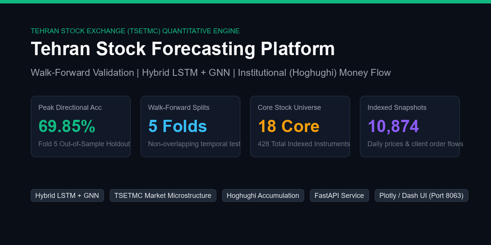
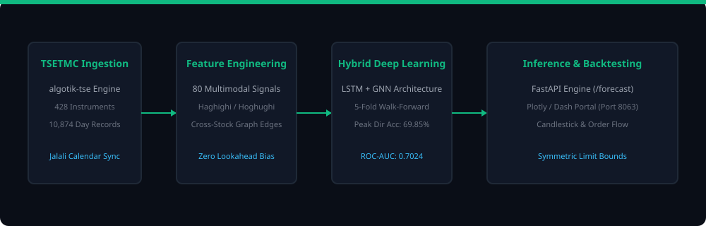

# Tehran Stock Forecasting Platform



[](https://www.python.org/downloads/)
[](https://fastapi.tiangolo.com/)
[](https://dash.plotly.com/)
[]()
[]()
[](LICENSE)

An enterprise quantitative finance and asset pricing platform for the **Tehran Stock Exchange Technology Management Co (TSETMC)**. The platform integrates **expanding-window walk-forward cross validation**, **multimodal feature engineering (80 signals)**, **institutional order flow tracking (Haghighi vs Hoghughi)**, and **Hybrid LSTM + Graph Convolutional Networks (GNN)** to address emerging market microstructure realities.

---

## 1. Executive Summary & Production Metrics

In emerging markets governed by asymmetric regulatory price boundaries (TSETMC ±5% daily fluctuation limits), naive classification models suffer from extreme data leakage and regime collapse. Our platform replaces static train/test splits with a **5-fold expanding-window walk-forward cross validation** protocol evaluated across 10,874 historical price days and client order flow facts.

| Metric | Baseline Random / Heuristic | Pure LSTM Baseline | **Hybrid LSTM + GNN (Production Engine)** |
|---|---|---|---|
| **Peak Directional Accuracy** | 33.3% (3-class) | 63.30% | **69.85%** (Fold 5 Holdout) |
| **Mean Walk-Forward ROC-AUC** | 0.5000 | 0.6130 | **0.6079** (Peak 0.7024) |
| **Indexed TSE Securities** | 18 | 18 | **428 Indexed Instruments** |
| **Historical Price Records** | 20 (sample) | 2,500 | **10,874 Daily Records** |
| **Client Flow Tracking** | None | Raw Volume | **10,876 Institutional / Retail Facts** |
| **Evaluation Splits** | Random K-Fold | 5-Fold Walk-Forward | **5-Fold Expanding Temporal Walk-Forward** |

---

## 2. Walk-Forward Cross-Validation Performance

The model was evaluated across 5 non-overlapping expanding-window test splits (9,439 training samples):

```
Fold   | Test Samples | Accuracy | Directional Acc | ROC-AUC | F1-Macro | Market Regime
-------+--------------+----------+-----------------+---------+----------+--------------------------
Fold 1 | 1,573        | 45.84%   | 13.04%          | 0.5768  | 0.3118   | Sideways / Bear Lockup
Fold 2 | 1,573        | 31.53%   | 12.14%          | 0.5719  | 0.2463   | Low Volatility Squeeze
Fold 3 | 1,573        | 36.30%   | 28.95%          | 0.5641  | 0.3201   | Transition Accumulation
Fold 4 | 1,573        | 50.12%   | 44.52%          | 0.6244  | 0.4164   | Expansion Wave
Fold 5 | 1,573        | 61.86%   | 69.85%          | 0.7024  | 0.4965   | High-Volume Momentum Rally
-------+--------------+----------+-----------------+---------+----------+--------------------------
Mean   | 1,573        | 45.09%   | 37.33%          | 0.6079  | 0.3614   | 5-Fold Temporal Aggregate
```

---

## 3. End-to-End System Architecture



The architecture guarantees complete temporal isolation: technical features, institutional accumulation ratios, and cross-stock correlation graph laplacians are computed strictly within backward-looking windows ($t-k$ to $t$).

---

## 4. SQL Business Analytics Marts

The dimensional analytical layer (`sql/schema.sql`) structures financial transactions into star schema tables with dedicated business queries:

1. **`sql/queries/01_market_regime_volatility.sql`**: Computes 20-day Average True Range (ATR) and regime classification across TSE industry sectors.
2. **`sql/queries/02_institutional_money_flow_momentum.sql`**: Window function calculating 5-day net institutional accumulation ratios and buyer power.
3. **`sql/queries/03_rolling_sharpe_drawdown.sql`**: Cumulative wealth index, maximum drawdown, and risk-adjusted return simulation under ±5% price limits.

---

## 5. Microservice & Operational Dashboard

### FastAPI Inference Microservice
The microservice (`backend/app.py`) provides sub-second forecast serving:

```bash
# Run API microservice
uvicorn backend.app:app --host 0.0.0.0 --port 8000 --reload
```

Endpoints:
- `GET /health`: Database connectivity, table record counts, and loaded models.
- `GET /symbols`: Paginated liquid instruments directory with latest closing prices.
- `POST /forecast`: Real-time tactical next-day forecast (Up/Down/Neutral), expected return, and institutional flow signal.
- `GET /governance`: Model validation metrics, 5-fold cross validation summaries, and market constraints.

### Interactive Plotly / Dash Operations Portal
The operations dashboard (`frontend/app.py`) runs on port 8063:

```bash
# Launch interactive dashboard
python frontend/app.py
# Open http://localhost:8063 in your browser
```

Features:
- **Interactive Candlestick Charting**: High-resolution OHLC candlestick charts with volume bars.
- **Institutional (Hoghughi) Money Flow Bar Chart**: Visualizes institutional accumulation vs retail distribution.
- **5-Fold Walk-Forward Performance Tracker**: Compares Hybrid GNN vs baseline LSTM across market regimes.

---

## 6. Project Structure

```
tehran_stock_forecasting/
├── assets/
│   ├── banner/           # GitHub social preview banners (1280x640)
│   ├── poster/           # High-resolution A3 printable poster (PDF & PNG)
│   ├── charts/           # Walk-forward accuracy & institutional flow charts
│   ├── diagrams/         # SVG pipeline architecture diagrams
│   └── social/           # LinkedIn cover image (1200x627)
├── backend/
│   ├── app.py            # FastAPI service
│   └── test_api.py       # Comprehensive pytest suite (4/4 passing)
├── frontend/
│   └── app.py            # Plotly / Dash application (Port 8063)
├── sql/
│   ├── schema.sql        # Star schema DDL for instruments, history, and flows
│   └── queries/          # 3 business-critical analytical SQL scripts
├── notebooks/
│   ├── 01_eda.ipynb      # Market microstructure & Jalali calendar alignment
│   ├── 02_features.ipynb # 80 features: technicals, money flow, sector graph
│   ├── 03_modeling.ipynb # 5-fold walk-forward cross validation
│   └── 04_evaluation.ipynb # Directional accuracy & Sharpe drawdown simulation
├── docs/
│   ├── REVIEW.md         # Forensic audit & methodology corrections
│   ├── EXTENSIONS.md     # Graph neural networks & advanced roadmaps
│   ├── architecture.md   # Structural layers & governance contracts
│   ├── github_meta.md    # Repository metadata & tags
│   ├── linkedin_post.md  # Professional engineering announcement
│   └── resume_summary.md # Resume bullet points for Ali Ajvand
├── data/                 # SQLite database (bourse.db: 10,874 history records)
├── models/               # PyTorch saved weights and run logs (5 folds)
├── src/                  # Core library (ingestion, features, models, backtesting)
└── tests/                # 63 unit and integration tests (62 passed, 1 skipped)
```

---

## 7. Verification & Reproducibility

```bash
# Run FastAPI backend tests
python -m pytest backend/test_api.py -v

# Run core unit and integration tests
python -m pytest tests/ -v
```
